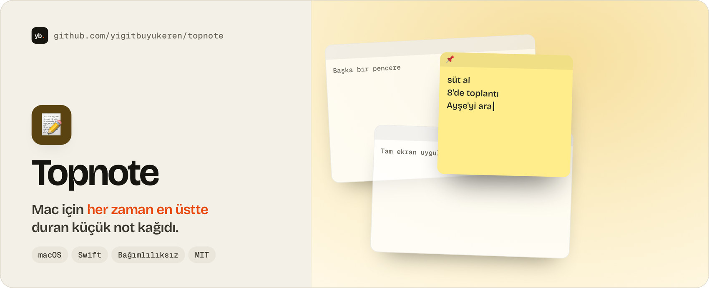

<a href="https://github.com/yigitbuyukeren/topnote">
  <picture>
    <source media="(prefers-color-scheme: dark)" srcset="docs/banner-dark.jpg">
    
  </picture>
</a>

# 📝 Topnote

Mac için küçük bir yapışkan not kağıdı. Ekranın köşesinde **her zaman en üstte** durur: pencere değiştirsen, başka masaüstüne geçsen, hatta bir uygulamayı tam ekran yapsan bile yerinden kıpırdamaz.

Tek not, hesap yok, sunucu yok, bağımlılık yok. Her şey yalnızca bu Mac'te tutulur.

## Özellikler

- 📌 **Her zaman üstte**: tüm pencerelerin, tüm masaüstlerinin ve tam ekran uygulamaların üstünde. İstersen tek tıkla kapatırsın.
- ⌨️ **Sistem genelinde kısayol**: `⌃⌥N` notu her yerden gösterir/gizler.
- 🎨 **6 renk**, ayarlanabilir yazı boyutu (`⌘+` / `⌘-`) ve saydamlık.
- 💾 **Otomatik kayıt**: yazdığın her şey, pencerenin yeri ve boyutu hatırlanır.
- 🫥 Dock'ta görünmez, menü çubuğunda küçük bir ikonu vardır.
- 🚀 İstersen girişte kendiliğinden açılır.

## Kurulum

macOS 13 veya üstü ve Xcode (ya da Command Line Tools) gerekir.

```bash
scripts/build-app.sh --install
```

Bu komut evrensel (Apple Silicon + Intel) `Topnote.app` üretir ve `~/Applications` içine kopyalar. `--install` olmadan paket `build/` altında kalır.

Uygulama Apple geliştirici hesabıyla imzalanmadığı için ilk açılışta macOS uyarı verirse uygulamaya sağ tıklayıp **Aç**'ı seç.

## Kullanım

| | |
|---|---|
| Göster / gizle | `⌃⌥N` ya da menü çubuğu ikonu |
| Üstte tut aç/kapat | not başlığındaki 📌 ya da `⌘P` |
| Renk | başlıktaki palet ya da menü |
| Yazı boyutu | `⌘+` / `⌘-` |
| Saydamlık | menü çubuğu → Saydamlık |
| Taşı / yeniden boyutlandır | başlığı sürükle / kenarları çek |
| Gizle | `⌘W` ya da ✕ (not silinmez) |

Not şuraya yazılır: `~/Library/Application Support/Topnote/not.json`.

## Geliştirme

```bash
swift build          # derle
swift test           # çekirdek (kayıt/yükleme) testleri
swift run Topnote   # doğrudan çalıştır
scripts/build-app.sh # .app paketi
```

| Yol | Ne |
|---|---|
| `Sources/TopnoteCore` | Not modeli ve diske kayıt (AppKit'ten bağımsız, test edilir) |
| `Sources/Topnote` | Uygulama: panel, SwiftUI görünümü, menüler, global kısayol |
| `scripts/build-app.sh` | `.app` paketler ve geçici (ad-hoc) imzalar |
| `scripts/make-icon.swift` | `Resources/AppIcon.icns` simgesini çizer |

## Lisans

[MIT](LICENSE)
